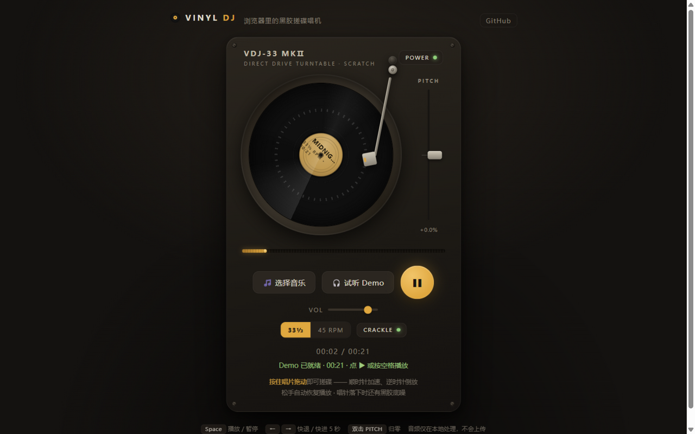

# Vinyl DJ · 浏览器里的黑胶搓碟唱机

[**在线体验 →**](https://slatinwine.github.io/vinyl-dj/)

把一台 Direct Drive 黑胶唱机搬进浏览器：加载任意音频文件，**按住唱片拖动即可搓碟**——顺时针加速、逆时针实时倒放，松手自动回到播放状态。无需安装、无需注册，音频全部在本地处理，不上传任何数据。



## 功能

- 🎛 **真·黑胶搓碟**：时间码原理的位置锁定，唱片跟手、可倒放、可急停，松手电机自动恢复转速
- 💿 **完整唱机拟物**：转盘频闪刻度、唱片纹路高光、随进度移动的唱臂、电机启停惯性
- 🔊 **音频引擎**：AudioWorklet 实时引擎（非已废弃的 ScriptProcessor），Catmull-Rom 插值保证变速/倒放音质
- ⏱ **33⅓ / 45 RPM** 双转速 + **±10% 音调推子**（双击归零），播放速率实时联动
- 🎧 **内置 Demo 节拍**：OfflineAudioContext 现场合成一段 Lo-Fi 循环，零素材也能开搓
- 🔥 **黑胶爆音（Crackle）**：唱针落下时的底噪与爆点，可开关
- 📍 进度条拖动跳转 · 空格播放/暂停 · 方向键快退/快进 · 全窗口拖放文件
- 📱 响应式布局，桌面/手机一屏可用；支持系统媒体控件（Media Session）
- 🌙 偏好记忆：音量、音调、转速、爆音、电源状态本地保存

## 使用

打开 [在线地址](https://slatinwine.github.io/vinyl-dj/)，然后：

1. 点「🎧 试听 Demo」或拖入 / 选择一个音频文件（MP3 / WAV / OGG / M4A / FLAC…）
2. 按 `▶` 或空格开始播放（唱片以 33⅓ 转旋转）
3. **在唱片上按住并拖动**开始搓碟，松手恢复

> 提示：搓碟一圈 = 1.8 秒音频（33⅓ RPM），切到 45 RPM 后一圈 = 1.33 秒，和真唱片一致。

## 技术要点

- **单文件部署**：整个应用是一个 `index.html`，AudioWorklet 处理器通过 Blob URL 内联，天然适合 GitHub Pages 等静态托管。
- **搓碟信号链**：`pointermove` 计算角度增量 → 换算为音频位置与速率 → worklet 内做软锁相（约 8ms 时间常数）与速率平滑，保证"唱片跟手"又不产生爆音。
- **音频关键路径不依赖 `requestAnimationFrame`**：渲染循环被节流（后台标签页等场景）时搓碟依然精准。
- **电机模型**：启动/停止按 0.2s 时间常数加减速，模拟直驱唱机的惯性。

## 本地运行

```bash
# 任意静态服务器即可，例如：
python -m http.server 8000
# 打开 http://127.0.0.1:8000
```

## 浏览器兼容

Chrome / Edge 121+、Firefox、Safari 14.1+（需要 AudioWorklet 与 `writing-mode` 纵向滑杆支持）。

## License

[MIT](LICENSE)
